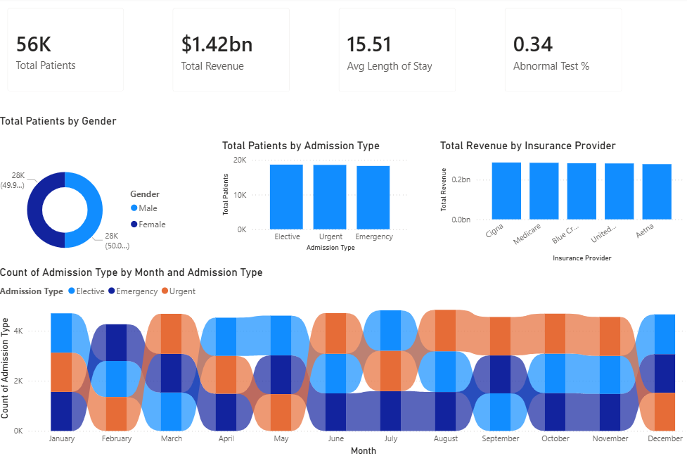
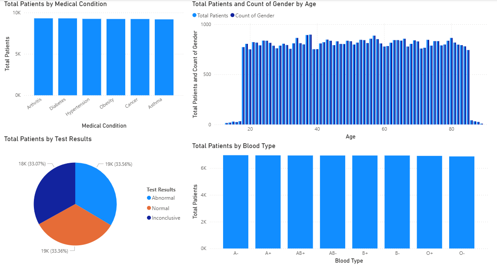
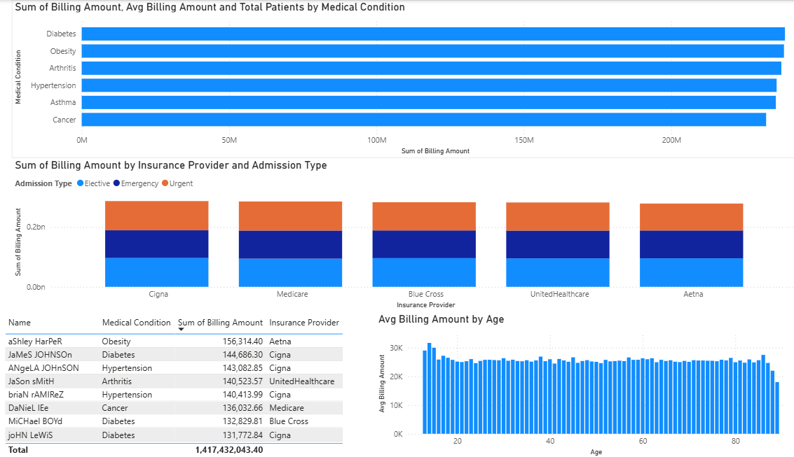
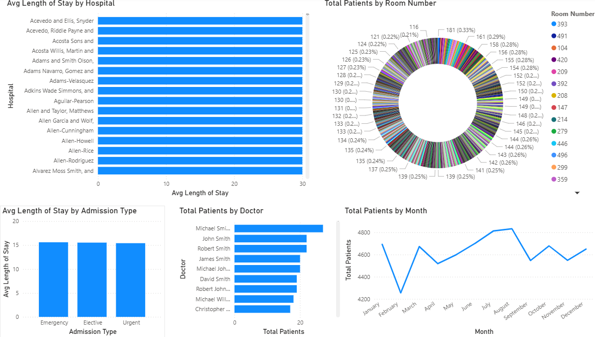
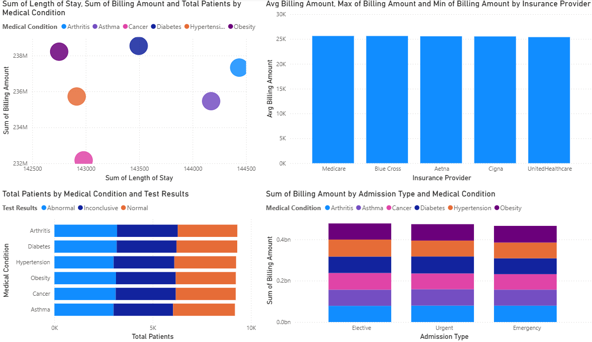

# Healthcare Analytics Dashboard



## Project Overview

This repository showcases a **Power BI Healthcare Analytics Dashboard** built to analyze patient demographics, medical conditions, operational efficiency, and financial performance across a healthcare dataset. The dashboard contains five report pages, and this README now includes the actual screenshots exported from those pages.

The solution is designed for:

- Healthcare administrators tracking admissions, utilization, and discharge behavior
- Finance teams monitoring billing patterns and insurance-provider performance
- Analysts exploring patient mix, diagnoses, medication trends, and outcome indicators

## Reports Included

### 1. Executive Overview


Provides a top-level business snapshot with KPI cards for total patients, total revenue, average length of stay, abnormal test percentage, and trend visuals across gender, admission type, insurance provider, and monthly admissions.

### 2. Patient & Medical Insights



Focuses on patient demographics and clinical patterns, including age group distribution, medical condition counts, blood type breakdown, medication analysis, and test-result mix.

### 3. Financial Analysis



Highlights billing performance through average, minimum, and maximum billing values, with report visuals centered on insurance providers, hospitals, medical conditions, and revenue concentration.

### 4. Operational Efficiency



Explores hospital operations through admission-type volume, doctor-level patient counts, average length of stay by segment, and operational trends that support throughput and planning analysis.

### 5. Advanced Insights



Brings together deeper comparative views such as billing by provider, billing by admission type and condition, and other cross-filtered insights for more detailed analytical exploration.

## Key Metrics

- Total Patients: **55,500**
- Total Billing Revenue: **$1.42B**
- Average Length of Stay: **15.5 days**
- Gender Split: **27,774 male / 27,726 female**
- Top Admission Category: **Elective**

## Dataset Details

- Source file: [healthcare_dataset.csv](healthcare_dataset.csv)
- Dashboard file: [Healthcare_Analytics.pbix](Healthcare_Analytics.pbix)
- Records: **55,500**
- Core fields:
  - Patient demographics
  - Admission and discharge dates
  - Medical condition
  - Medication and test results
  - Hospital, doctor, and insurance provider
  - Billing amount and admission type

## Tools Used

- **Power BI Desktop** for dashboard creation and storytelling
- **Power Query** for data shaping and preparation
- **DAX** for calculated measures and KPI creation
- **CSV dataset** as the primary data source

## Repository Structure

```text
Healthcare Analytics/
|-- Healthcare_Analytics.pbix
|-- healthcare_dataset.csv
|-- Executive_Overview.png
|-- Patients_and_Medical_Insights.png
|-- Financial_Analysis.png
|-- Operational_Efficiency.png
|-- Advanced_Insights.png
|-- screenshots/
|-- scripts/
|   `-- generate_preview_images.ps1
|-- .gitignore
`-- README.md
```

## How To Use

1. Open [Healthcare_Analytics.pbix](Healthcare_Analytics.pbix) in Power BI Desktop.
2. Refresh the dataset if needed.
3. Explore the five report pages through slicers and visuals.
4. Review the exported report screenshots in this repository for a quick view of each dashboard page.

## Portfolio Value

This project demonstrates:

- End-to-end Power BI dashboard development
- Healthcare domain analysis using operational and financial KPIs
- Report design for executive and analytical audiences
- Data storytelling through multi-page interactive reporting

## Author

**Indira Kallam**

GitHub Portfolio project for Power BI and data analytics work.
